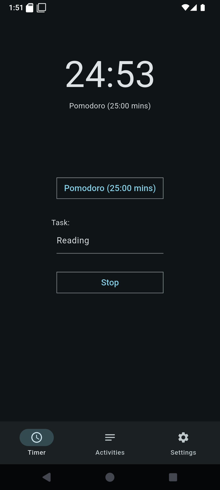
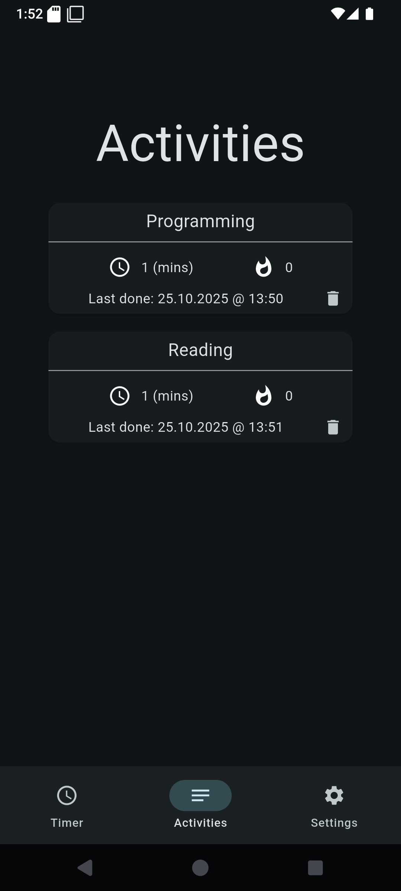
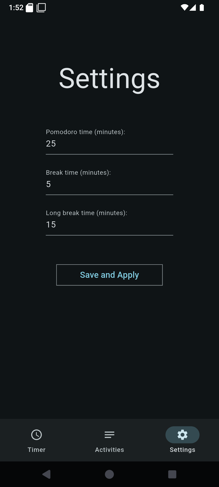

# PomoSlice
A productivity tool that merges the Pomodoro technique with a robust local data tracker. It provides a simple timer for deep focus and insightful stats to help you stay motivated and on top of your goals.

## Android release build

The Android build uses Flutter 3.47.7, Gradle 9.7.0, Android Gradle Plugin
9.3.1, Kotlin 2.4.21, and Android SDK 37 (`compileSdk` and `targetSdk`).
Install SDK Platform 37, Build Tools 36.0.0, and NDK 28.2.13676358.
The minimum Android version follows Flutter's default (API 24 in Flutter 3.47).

On this workstation, select the installed JDK 25 for Flutter builds:

```sh
flutter config --jdk-dir=/usr/lib/jvm/java-25-openjdk-amd64
flutter build appbundle --release
```

`flutter config` changes the JDK for all Flutter projects on this workstation.
Java and Kotlin bytecode target Java 17 for Android compatibility.
Kotlin support is built into AGP (`android.builtInKotlin=true`); the app does not
apply the legacy Kotlin Android plugin. The compiler version is pinned in
`android/settings.gradle.kts`. Flutter 3.47 still needs the legacy AGP DSL
compatibility flag (`android.newDsl=false`).

For Google Play, configure `android/key.properties` with the release upload key
and use a positive build number higher than the last uploaded version, for example
`flutter build appbundle --release --build-number=2`. Without `key.properties`,
the current build configuration falls back to the debug signing key.

## Screenshots

| Timer Screen | Activities Screen | Settings Screen |
|:---:|:---:|:---:|
|  |  |  |
